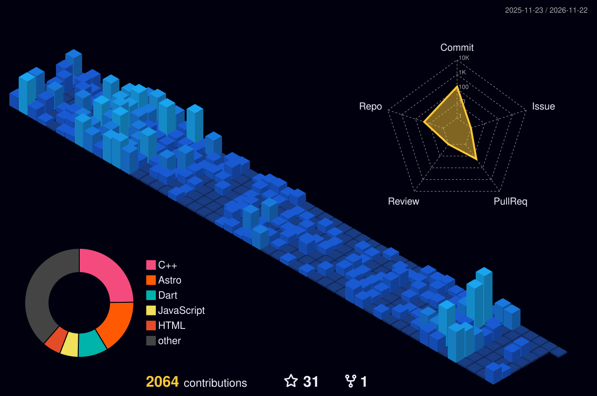

<div align="center">

<br/>

<br/>
<a href="https://www.linkedin.com/in/hedra-nabil-6043221a4/"></a>
<a href="mailto:hedranabil614@gmail.com"></a>
<a href="https://wa.me/201064456538"></a>

 
</div>

<h2>🚀 About Me</h2>
 
```dart
class HedraNabil extends SoftwareEngineer {
  final String location = "Egypt";
 
  final List<String> focus = [
    "Mobile Engineering",
    "Backend Systems",
    "DevOps & Infrastructure",
    "AI Integrations",
    "Scalable Architecture",
  ];
 
  final String philosophy =
      "Build simple. Design for scale. Automate everything possible.";
}
```
 
I'm a **Software Engineer** with a strong background in **Flutter and cross-platform mobile development**, expanding deeper into **backend engineering, distributed systems, DevOps and AI-powered automation**.
 
I like working where multiple disciplines meet — mobile apps, backend APIs, AI workflows, containerized infrastructure, CI/CD, databases, production web systems, integrations and monitoring.
 
> **I don't just like building features. I like understanding how the entire system works.**
 

<h2>⚡ What I'm Building</h2>
 
### 🚘 EgyptLimo — Transportation Technology Platform
 
A transportation and airport-transfer platform built around a multi-service architecture.
 
```text
        ┌──────────────────────────────┐
        │          Customers           │
        └──────────────┬───────────────┘
                       │  Web / Mobile
        ┌──────────────▼───────────────┐
        │       Application Layer      │
        │    Next.js • Flutter • APIs  │
        └──────────────┬───────────────┘
        ┌──────────────▼───────────────┐
        │       Backend Services       │
        │ Laravel • REST • Integration │
        └───────┬──────────────┬───────┘
         ┌──────▼─────┐  ┌─────▼──────┐
         │  Pricing   │  │  Tickets   │
         └──────┬─────┘  └─────┬──────┘
        ┌───────▼──────────────▼───────┐
        │    MySQL • Redis • Workers   │
        └──────────────┬───────────────┘
                       │
          Docker • Nginx • Cloudflare
```
 
**Engineering areas:** dynamic pricing · airport transfer booking · payments · ticketing integrations · SEO destination pages · admin dashboards · Redis caching · background workers · WebSockets · Dockerized deployment · Cloudflare security · monitoring · automation.
 
> Building software is one thing. **Keeping it fast, secure and reliable in production is another.**
 

<h2>🛠️ Tech Stack</h2>
 
<div align="center">
<table>
<tr><th>📱 Mobile</th><th>⚙️ Backend</th><th>☁️ DevOps</th><th>🤖 AI & Automation</th><th>🗄️ Data</th><th>🌐 Web</th></tr>
<tr><td align="center" valign="top">Flutter<br/>Dart<br/>BLoC / Cubit<br/>Riverpod<br/>Firebase</td><td align="center" valign="top">Laravel<br/>REST APIs<br/>WebSockets<br/>Auth<br/>Service Architecture</td><td align="center" valign="top">Docker<br/>Nginx<br/>Linux<br/>Cloudflare<br/>CI/CD</td><td align="center" valign="top">Python<br/>LLM APIs<br/>n8n<br/>TensorFlow<br/>PyTorch</td><td align="center" valign="top">MySQL<br/>PostgreSQL<br/>MongoDB<br/>Redis<br/>SQLite</td><td align="center" valign="top">Next.js<br/>React<br/>SSR / ISR<br/>PWA<br/>SEO</td></tr>
</table>
<br/>

<br/>

</div>

<h2>🌟 Featured Projects</h2>
 
### 🔐 SirrVault — Password Generator & Secure Local Vault
 
<a href="https://play.google.com/store/apps/details?id=com.sirrvault.app"></a>

 
A privacy-focused app for generating strong passwords and storing them in an encrypted vault directly on the user's device — fast, lightweight, no unnecessary tracking.
 
### 🗣️ S2S — Speech-to-Sign
 
AI-powered sign language translation: **Speech → AI Processing → Language Interpretation → Sign Representation → Flutter Interface**. The goal is to reduce communication barriers with AI and mobile technology.
 
### 🚚 Al-Naqla — Logistics Platform
 
Fleet operations, driver workflows, shipment management, mobile apps, web dashboards and containerized services.
 
### 🧪 Other Projects
 
<div align="center">
<a href="https://github.com/Hedra-Nabil/BMI_App"></a>
<a href="https://github.com/Hedra-Nabil/movie_app"></a>
<a href="https://github.com/Hedra-Nabil/To-Do_App"></a>
 
</div>

<h2>🏗️ How I Think About Software</h2>
 
```text
Readable → Maintainable → Testable → Observable → Automated → Scalable
```
 
> **Don't introduce complexity because it looks impressive. Introduce complexity only when the problem actually requires it.**
 
**Flutter:** Clean Architecture · BLoC/Cubit · Riverpod · DI · Dio · caching · local persistence · Google Maps · isolates · Android release pipelines.
**APIs:** every integration needs authentication, retries, idempotency, logging, monitoring, rate limiting, validation and graceful failure.
**Infra:** VPS · Ubuntu · Docker Compose · Nginx · SSL/DNS · Cloudflare WAF · GitHub Actions · performance troubleshooting.
**AI:** used where it creates real operational value — assistants, LLM integrations, n8n workflows, speech processing, accessibility.
 

<h2>🏆 Certifications & Training</h2>
 
<div align="center">


</div>

<h2>📊 GitHub Analytics</h2>
 
<div align="center">


<br/>

<br/><br/>
 

<br/>
<picture>
  <source media="(prefers-color-scheme: dark)" srcset="https://raw.githubusercontent.com/Hedra-Nabil/Hedra-Nabil/output/snake-dark.svg" />
  <source media="(prefers-color-scheme: light)" srcset="https://raw.githubusercontent.com/Hedra-Nabil/Hedra-Nabil/output/snake-light.svg" />
  
</picture>
</div>

<h2>💡 Currently Exploring</h2>
 
```yaml
architecture: [Distributed Systems, Microservices, Event-Driven Architecture]
infrastructure: [Load Balancing, High Availability, Kubernetes]
backend: [Service Separation, Queue Architecture, Caching, Database Scaling]
ai: [LLM Applications, AI Agents, Workflow Automation]
```
 
**Goal:** take a product through the whole lifecycle — Idea → Architecture → Development → Testing → Deployment → Monitoring → Scaling → Optimization. Not only *"How do I implement this?"* but *"How will this behave with real users, real traffic and real production failures?"*
 
<div align="center">
### 🤝 Let's Build Something
 
<a href="mailto:hedranabil614@gmail.com"></a>
<a href="https://wa.me/201064456538"></a>
<a href="https://www.linkedin.com/in/hedra-nabil-6043221a4/"></a>
 
**"The best engineers don't just write code. They understand the system around it."**
 

</div>
 
